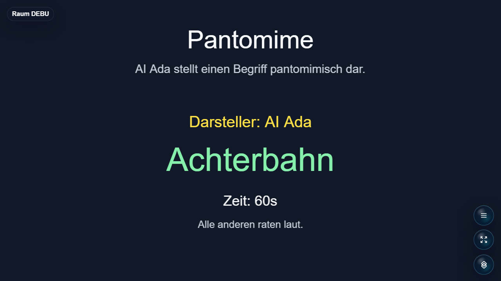

# Pantomime

Supports 2–20 players in solo mode and 4–20 players in team mode.

Charades-style Open Party Lab game where one player performs prompts while the others guess.



## Status

Alpha. Private prompts, timed multi-word actor turns, Solo / Teams, oral guessing with phone claims, and actor-controlled score review are implemented. Physical-phone playtesting remains pending.

## Run Through Open Party Lab

This repo is not a standalone app. Run it through the Open Party Lab platform.

Recommended layout:

```text
Open-Party-Lab/
  local-games/
    pantomime/
```

From the Platform repo:

```bash
npm install
npm run games:sync-local
npm run dev:all
```

The Platform loads this game only when the repo exists locally and `npm run games:sync-local` links it. Missing optional games are skipped.

## GitHub Metadata

Description:

```text
Charades-style Open Party Lab game where one player performs prompts while the others guess.
```

Suggested topics:

```text
open-party-lab party-game browser-game phaser typescript local-multiplayer charades
```

## Package Entrypoints

- `@open-party-lab/game-pantomime/manifest`
- `@open-party-lab/game-pantomime/protocol`
- `@open-party-lab/game-pantomime/server`
- `@open-party-lab/game-pantomime/host`
- `@open-party-lab/game-pantomime/controller`

The Platform should import only these public entrypoints.

## Development Checks

```bash
npm install
npm run typecheck
npm run build
npm test
npm run pack:dry-run
```

For visual checks, start Open Party Lab, add virtual controllers when needed, and capture host screenshots through a browser.

## License

Code is licensed under the Apache License 2.0. See [LICENSE](LICENSE).

Assets, generated media, word lists, prompts, and third-party references may need separate rights review before public store distribution.

## Begriff und Rundenzeit

Alle Begriffe sind auf Deutsch und Englisch höchstens zwei Wörter lang. Nach einem Treffer zeigt der Controller der ratenden Person den erratenen Begriff zwei Sekunden lang als Bestätigung. Für diese zwei Sekunden sind „Erraten“ bei allen und „Weiter“ beim Darsteller gesperrt. Auch nach dem Überspringen eines Begriffs gilt dieselbe Zwei-Sekunden-Sperre. Die Sperre wird vom Server geprüft, läuft mit der pausierbaren Rundenzeit und verändert weder das Zeitlimit noch das Skip-Kontingent. Der nächste Begriff erscheint weiterhin sofort privat beim Darsteller.

Im Setup stehen **U18**, **Ü18** und **Alle** zur Auswahl. U18 ist die Voreinstellung mit 124 familienfreundlichen Begriffen. Ü18 enthält 76 eigene Begriffe aus Sex, Beziehungen, Nachtleben und derben Alltagsszenen. Alle mischt beide Vorräte und richtet sich an erwachsene Gruppen. Sämtliche 200 Begriffe sind auf Deutsch und Englisch vorhanden; U18 enthält keine Ü18-Begriffe.

Im Setup werden **Solo / Teams**, **15–300 Sekunden pro Darsteller** (Standard 60) und **0–10× Weiter pro Zug** (Standard 3) eingestellt. Es gibt keine Begriffsauswahl. Erst „Ersten Begriff aufdecken & starten“ zeigt einen zufälligen Begriff privat und startet die Zeit. Jeder Treffer bringt sofort den nächsten Begriff; die Uhr und das Skip-Kontingent laufen dabei unverändert weiter. Gespielte und übersprungene Begriffe wiederholen sich erst nach Durchlaufen des Vorrats.

**Solo (jeder gegen jeden):** Alle außer dem Darsteller raten laut. Wer richtig geraten hat, tippt selbst „Erraten“. Die erste gültige Meldung beansprucht den Begriff. Pro zugeordnetem Treffer erhalten die ratende Person und der Darsteller je einen Punkt.

**Teams (ab vier Personen):** Zwei Teams werden abwechselnd nach Beitrittsreihenfolge gebildet, wie bei Buzzwort. Teams wechseln sich ab; innerhalb eines Teams wechseln die Darsteller. Nur die Mitspieler des aktiven Teams dürfen raten und „Erraten“ drücken. Pro zugeordnetem Begriff gibt es einen Teampunkt.

**Nach Zeitablauf:** Alle gespielten Begriffe und ihre Zuordnung bleiben auf Host und Handys sichtbar. Nur der Darsteller kann Treffer zurücknehmen („Kein Punkt“) oder einer anderen berechtigten Person zuordnen. Auch übersprungene und bei Zeitablauf offene Begriffe können noch zugeordnet werden. Punkte ändern sich sofort, ohne doppelte Wertung. Erst „Bestätigen & nächste Person“ schließt den Zug ab. Die nächste Person erhält wieder die volle Zeit und das volle Skip-Kontingent, sobald sie ihren ersten Begriff aufdeckt; es gibt kein automatisches Bereitmelden.

Die Punkte gelten nur für Pantomime und werden beim neuen Spielstart zurückgesetzt. Später Beigetretene spielen ab dem nächsten Zug mit; Teams bleiben bei Wiederverbindung erhalten. Bei Abbruch der Darsteller-Verbindung während des Zuges gibt es bis zu 15 Sekunden zum Wiederverbinden (innerhalb des laufenden Zeitlimits), danach wird die Auswertung geöffnet. Die Darsteller-Person muss wieder verbunden sein, um zu korrigieren und weiterzugeben. Der Host kann das Spiel jederzeit über das Spielmenü beenden. Regeln und Rollenansichten sind auf Deutsch und Englisch verfügbar.

Regressionstest: npm test (Geheimhaltung, Berechtigung, Zeitlimit, Wertung und Rundenreset).

Host und Handy verwenden für den Countdown dieselbe monotone Serverzeit. Die
Plattform gleicht Geräteuhr-Abweichungen und Netzwerklatenz regelmäßig sowie nach
Wiederverbindung ab. Die bestehende Host-Oberfläche bleibt erhalten; ein
illustrierter Neuentwurf ist bisher nur ein Konzept.
